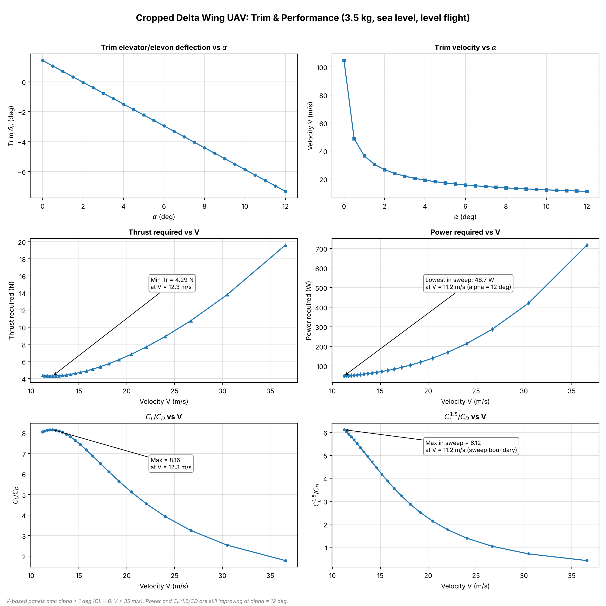

# Trim, Thrust Required and Power Required of a Cropped Delta Wing UAV

Numerical analysis of the longitudinal trim condition, thrust required, power required and aerodynamic efficiency of a 3.5 kg cropped delta wing UAV (wing alone, no separate tail) in steady level flight at sea level, for angles of attack from 0° to 12° in 0.5° steps. Coursework project (BSERC, Project 4), implemented in Python and MATLAB.

## Key results (0°–12° sweep)

| Quantity | Value | Condition |
| --- | --- | --- |
| Minimum thrust required | 4.29 N | α = 10.0°, V = 12.26 m/s, δe = −5.87° |
| Maximum CL/CD | 8.16 | same point as minimum thrust (best range) |
| Lowest power required in the sweep | 48.74 W | α = 12.0°, V = 11.21 m/s, δe = −7.33° |
| Highest CL^1.5/CD in the sweep | 6.12 | α = 12.0° (sweep boundary) |

**Important:** power required is still decreasing at α = 12°, so the 48.74 W and 6.12 values are the best *within the specified sweep*, not the true optimum. For the parabolic polar, the theoretical minimum power occurs at CL = √(3·CD0/k) ≈ 0.85, i.e. α ≈ 17.7°, V ≈ 9.25 m/s, Pr ≈ 45.8 W. That is outside the 0°–12° range and was not validated against a stall limit.

## Inputs

| Parameter | Symbol | Value |
| --- | --- | --- |
| Mass | m | 3.5 kg |
| Gravity (as specified in the assignment) | g | 10.0 m/s² |
| Air density (sea level) | ρ | 1.225 kg/m³ |
| Root chord / tip chord / span | Cr / Ct / b | 0.90 / 0.15 / 1.50 m |
| Oswald efficiency | e | 0.89 |
| Zero-lift drag coefficient | CD0 | 0.03 |
| Zero-alpha pitching moment | Cm0 | 0.01 |
| Lift-curve slope | CLα | 2.92 rad⁻¹ |
| Elevator lift effectiveness | CLδe | 0.265 rad⁻¹ |
| Pitching-moment slope | Cmα | −0.292 rad⁻¹ |
| Elevator pitch effectiveness | Cmδe | −0.4 rad⁻¹ |

The aircraft has no separate tail, so "elevator" deflection δe represents elevon deflection (trailing-edge control surfaces acting together).

Derived geometry: λ = Ct/Cr = 0.1667, S = (b/2)·Cr·(1+λ) = 0.7875 m², AR = b²/S = 2.857, k = 1/(π·e·AR) = 0.1252.

## Method

For each α (in radians), with weight W = m·g = 35 N:

1. Trim elevator: δe = −(Cm0 + Cmα·α) / Cmδe  (from Cm = 0)
2. Trim lift coefficient: CL = CLα·α + CLδe·δe
3. Trim speed (L = W): V = √(2W / (ρ·S·CL))
4. Drag coefficient: CD = CD0 + k·CL²
5. Thrust required (T = D): Tr = ½·ρ·V²·S·CD
6. Power required (aerodynamic): Pr = Tr·V
7. Efficiency metrics: CL/CD (range) and CL^1.5/CD (endurance)

## Results table

| α (deg) | δe (deg) | CL | V (m/s) | CD | Tr (N) | Pr (W) | CL/CD | CL^1.5/CD |
| --- | --- | --- | --- | --- | --- | --- | --- | --- |
| 0.0 | +1.43 | 0.0066 | 104.66 | 0.0300 | 158.52 | 16589.97 | 0.22 | 0.02 |
| 0.5 | +1.07 | 0.0304 | 48.84 | 0.0301 | 34.65 | 1692.42 | 1.01 | 0.18 |
| 1.0 | +0.70 | 0.0542 | 36.59 | 0.0304 | 19.61 | 717.29 | 1.79 | 0.42 |
| 1.5 | +0.34 | 0.0780 | 30.50 | 0.0308 | 13.80 | 420.96 | 2.54 | 0.71 |
| 2.0 | -0.03 | 0.1018 | 26.70 | 0.0313 | 10.76 | 287.28 | 3.25 | 1.04 |
| 2.5 | -0.39 | 0.1256 | 24.04 | 0.0320 | 8.91 | 214.18 | 3.93 | 1.39 |
| 3.0 | -0.76 | 0.1494 | 22.04 | 0.0328 | 7.68 | 169.33 | 4.56 | 1.76 |
| 3.5 | -1.12 | 0.1732 | 20.47 | 0.0338 | 6.82 | 139.64 | 5.13 | 2.14 |
| 4.0 | -1.49 | 0.1970 | 19.19 | 0.0349 | 6.19 | 118.88 | 5.65 | 2.51 |
| 4.5 | -1.85 | 0.2208 | 18.13 | 0.0361 | 5.72 | 103.76 | 6.12 | 2.87 |
| 5.0 | -2.22 | 0.2446 | 17.23 | 0.0375 | 5.36 | 92.41 | 6.52 | 3.23 |
| 5.5 | -2.58 | 0.2684 | 16.44 | 0.0390 | 5.09 | 83.67 | 6.88 | 3.56 |
| 6.0 | -2.95 | 0.2921 | 15.76 | 0.0407 | 4.87 | 76.81 | 7.18 | 3.88 |
| 6.5 | -3.31 | 0.3159 | 15.15 | 0.0425 | 4.71 | 71.34 | 7.43 | 4.18 |
| 7.0 | -3.68 | 0.3397 | 14.61 | 0.0444 | 4.58 | 66.92 | 7.64 | 4.46 |
| 7.5 | -4.04 | 0.3635 | 14.13 | 0.0465 | 4.48 | 63.31 | 7.81 | 4.71 |
| 8.0 | -4.41 | 0.3873 | 13.69 | 0.0488 | 4.41 | 60.33 | 7.94 | 4.94 |
| 8.5 | -4.77 | 0.4111 | 13.29 | 0.0512 | 4.36 | 57.86 | 8.04 | 5.15 |
| 9.0 | -5.14 | 0.4349 | 12.92 | 0.0537 | 4.32 | 55.80 | 8.10 | 5.34 |
| 9.5 | -5.50 | 0.4587 | 12.58 | 0.0563 | 4.30 | 54.07 | 8.14 | 5.51 |
| 10.0 | -5.87 | 0.4825 | 12.26 | 0.0591 | 4.29 | 52.61 | 8.16 | 5.67 |
| 10.5 | -6.23 | 0.5063 | 11.97 | 0.0621 | 4.29 | 51.38 | 8.15 | 5.80 |
| 11.0 | -6.60 | 0.5301 | 11.70 | 0.0652 | 4.30 | 50.35 | 8.13 | 5.92 |
| 11.5 | -6.96 | 0.5539 | 11.45 | 0.0684 | 4.32 | 49.47 | 8.10 | 6.03 |
| 12.0 | -7.33 | 0.5777 | 11.21 | 0.0718 | 4.35 | 48.74 | 8.05 | 6.12 |

The same data is in `results.csv`.



The speed-based panels omit α < 1° (CL ≈ 0, V > 35 m/s) so that the useful region is readable; the table above includes every point.

## Discussion

- **Trim:** δe decreases linearly with α because Cmα < 0 (statically stable); more trailing-edge-up deflection is needed at higher α. δe crosses zero near α = 2°.
- **Speed:** higher α means higher CL, so the level-flight speed falls from about 49 m/s at α = 0.5° to 11.2 m/s at α = 12°. The α = 0° point (CL = 0.0066, V ≈ 105 m/s) is not a practical flight condition for this UAV.
- **Thrust required and range:** thrust required is minimum at the maximum CL/CD. The analytical optimum, CL = √(CD0/k) = 0.49 (V ≈ 12.2 m/s), agrees with the sweep result (CL = 0.4825 at α = 10°). This holds for any aircraft in steady level flight, not only jets.
- **Power required and endurance:** minimum power occurs at a lower speed than minimum thrust. For a parabolic polar V_endurance = 3^(−1/4)·V_range ≈ 0.76·V_range ≈ 9.3 m/s, which is below the 11.2 m/s limit of this sweep. That is why Pr and CL^1.5/CD are still improving at α = 12°.

## Limitations

- The model is linear in α with no CLmax or stall model; results near the upper end of the sweep (and the extrapolated optimum at ≈ 17.7°) are unvalidated.
- Pr = Tr·V is aerodynamic power. Electrical power would be Pr / (η_prop · η_motor · η_ESC), which are not given here.
- CD0, k and all derivatives are taken as constant and come from the assignment, not from tests or CFD.
- Trim drag from the control surface is included only through CL in the drag polar.

## Running the code

```bash
pip install -r requirements.txt
python src/project4_solver.py        # prints the table, writes results.csv and the PNG
```

MATLAB: open the repository folder and run `project4_solver` (from `src/`). It prints the table, writes `results_matlab.csv` and saves `cropped_delta_uav_performance_matlab.png`.

## Repository structure

```text
├── README.md
├── SYNOPSIS.md
├── LICENSE
├── requirements.txt
├── results.csv
├── cropped_delta_uav_performance.png
└── src/
    ├── project4_solver.py
    └── project4_solver.m
```

## References

- Project 4 specification, BSERC aircraft design course.
- Sadraey, M. *Unmanned Aircraft Design: A Review of Fundamentals.*
- BSERC Aircraft Design Study Material (Dr. J. Sarathkumar Sebastin).
